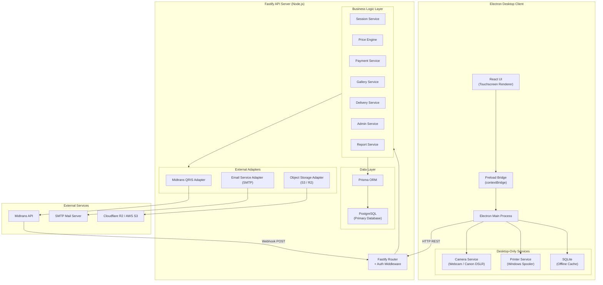
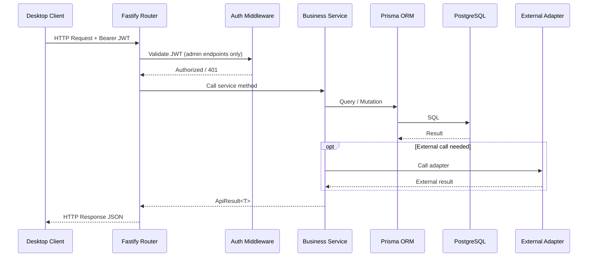
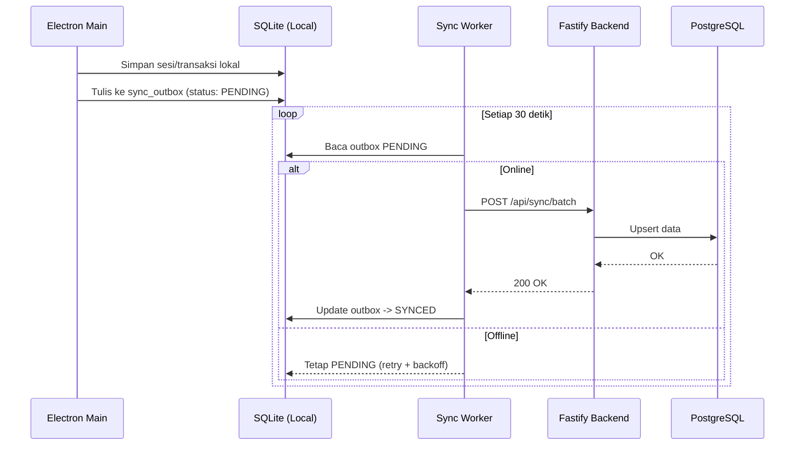
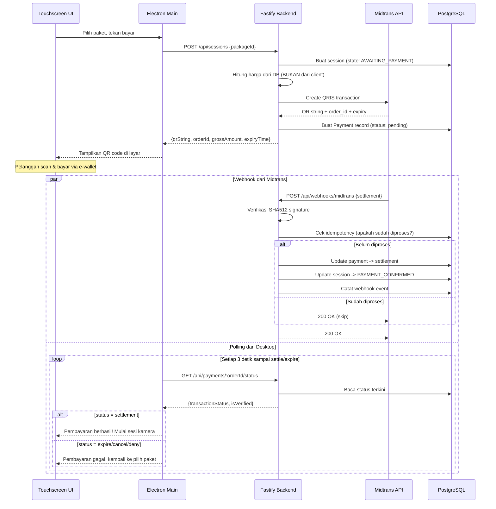

# MINJAPHOTOBOOTH — SOFTWARE ARCHITECTURE DOCUMENT

**Versi:** 2.0  
**Terakhir diperbarui:** 2026-10-17  
**Status:** Draft — Menunggu Review  
**Target Platform:** Windows 10/11 64-bit  

---

## 1. Ringkasan Eksekutif

MinjaPhotobooth terdiri dari dua sistem terpisah yang berkomunikasi satu sama lain:

1. **Backend API Server** — Proses Node.js (Fastify) yang menangani seluruh logika bisnis, database, pembayaran, dan integrasi eksternal.
2. **Desktop Client** — Aplikasi Electron (React + Vite + TypeScript) yang menampilkan antarmuka touchscreen dan mengelola perangkat keras lokal (kamera, printer).

Pemisahan ini menjamin bahwa:
- Rahasia (server key, token API) hanya berada di backend dan tidak pernah dikirim ke renderer.
- Harga dikalkulasi ulang oleh backend; frontend tidak dipercaya.
- Desktop client hanya mengirim request HTTP ke backend dan menerima response terstruktur.
- Perangkat keras lokal (kamera, printer) dikelola oleh desktop service, bukan oleh backend API.

---

## 2. Prinsip Desain

| # | Prinsip | Penjelasan |
|---|---------|------------|
| 1 | **Separation of Concerns** | Frontend menampilkan UI. Backend menghitung harga dan memvalidasi status. Desktop service mengelola hardware. |
| 2 | **Zero Secrets in Frontend** | Midtrans Server Key, kredensial SMTP Email, database password tidak pernah ada di Electron renderer atau preload. |
| 3 | **Server-Side Price Authority** | Client mengirim `packageId` dan `additionalPrints`. Backend mengambil harga dari database dan menghitung total. Client tidak mengirim harga. |
| 4 | **Payment Verification by Backend** | Sesi kamera hanya aktif setelah backend memvalidasi status `settlement` dari Midtrans. Redirect atau tampilan QRIS di frontend bukan bukti pembayaran. |
| 5 | **Adapter Pattern** | Setiap integrasi eksternal (Midtrans, Layanan Email SMTP, Object Storage, DSLR, Printer) dienkapsulasi dalam adapter dengan interface TypeScript. |
| 6 | **Offline-First Data** | SQLite lokal menyimpan salinan operasional. Sync worker mendorong data ke PostgreSQL saat online. Booth tetap berfungsi tanpa internet. |
| 7 | **Idempotent Operations** | Webhook Midtrans dan perintah cetak menggunakan kunci idempoten. Notifikasi ganda tidak menyebabkan sesi ganda atau cetak berulang. |

---

## 3. Diagram Arsitektur Sistem



---

## 4. Batas Tanggung Jawab: Online API vs Desktop Service

Ini adalah keputusan arsitektur paling penting. Setiap operasi hanya boleh berjalan pada satu sisi:

### 4.1 Backend API Server (Fastify) — ONLINE

Bertanggung jawab atas:

| Domain | Operasi |
|--------|---------|
| **Auth** | Verifikasi PIN admin (Argon2id), penerbitan JWT, logout |
| **Settings** | CRUD pengaturan publik (branding) dan pengaturan admin |
| **Packages** | CRUD paket sesi (nama, harga, durasi, batas foto) |
| **Templates** | CRUD template foto (metadata, koordinat slot) |
| **Sessions** | Membuat sesi, mengubah state, menyelesaikan/membatalkan sesi |
| **Pricing** | Kalkulasi total harga berdasarkan paket + tambahan cetak |
| **Payments** | Membuat transaksi Midtrans QRIS, menerima webhook, polling status, verifikasi signature |
| **Photos** | Menyimpan metadata foto per sesi |
| **Gallery** | Membuat tautan galeri privat, mengelola token dan retensi |
| **Email** | Mengirim pesan soft file melalui Layanan Email (SMTP / Nodemailer) |
| **Object Storage** | Upload/download foto ke S3/R2 |
| **Reports** | Query laporan transaksi, ekspor CSV |
| **Audit Log** | Mencatat setiap tindakan admin |
| **Webhooks** | Menerima notifikasi Midtrans dengan verifikasi signature SHA512 |
| **App Update** | Endpoint cek versi terbaru dan URL download installer |

### 4.2 Desktop Service (Electron Main) — LOKAL

Bertanggung jawab atas:

| Domain | Operasi |
|--------|---------|
| **Camera** | Enumerasi perangkat, connect/disconnect, live preview stream, shutter capture |
| **Printer** | Enumerasi printer Windows, submit print job ke spooler, cek status job |
| **Local Storage** | SQLite sebagai cache offline (sesi, transaksi, konfigurasi booth) |
| **Sync Worker** | Menyinkronkan data lokal ke PostgreSQL saat online |
| **Image Rendering** | Komposit foto + template + filter ke resolusi 4R (300 DPI) menggunakan Sharp |
| **File Management** | Menyimpan dan menghapus file foto sementara dari disk lokal |

### 4.3 Aturan Komunikasi

```
┌───────────────────────┐         HTTP REST (JSON)         ┌──────────────────────┐
│   Desktop Client      │ ──────────────────────────────▶  │  Fastify API Server  │
│   (Electron)          │ ◀──────────────────────────────  │  (Node.js)           │
└───────────────────────┘                                  └──────────────────────┘
       │                                                          │
       │ IPC (contextBridge)                                      │ Prisma ORM
       │                                                          │
       ▼                                                          ▼
┌───────────────────────┐                                  ┌──────────────────────┐
│ Camera / Printer /    │                                  │ PostgreSQL           │
│ SQLite / Sharp        │                                  │ Midtrans / Email / S3│
└───────────────────────┘                                  └──────────────────────┘
```

- Desktop client berkomunikasi ke backend **hanya melalui HTTP REST**.
- Renderer berkomunikasi ke Electron Main **hanya melalui typed IPC** (contextBridge).
- Backend tidak pernah mengakses kamera atau printer secara langsung.
- Desktop tidak pernah mengakses PostgreSQL, Midtrans, atau Layanan Email secara langsung.

---

## 5. Stack Teknologi Detail

### 5.1 Backend API Server

| Komponen | Teknologi | Alasan |
|----------|-----------|--------|
| Runtime | Node.js 20 LTS | Stabil, dukungan jangka panjang |
| Framework | Fastify 5 | Performa tinggi, schema validation bawaan, plugin ecosystem |
| ORM | Prisma 6 | Type-safe queries, migrasi database terkelola, support PostgreSQL & SQLite |
| Database | PostgreSQL 16 | ACID compliance, JSON support, scalable |
| Validasi | Zod + Fastify schemas | Runtime type checking, integrasi TypeScript |
| Auth | JWT (jsonwebtoken) + Argon2id (argon2) | Stateless auth token, hashing PIN aman |
| Payments | Midtrans Node.js SDK / HTTP client | Integrasi QRIS resmi |
| Messaging | Nodemailer (SMTP) | Pengiriman soft file via server SMTP resmi |
| Storage | AWS SDK v3 / S3-compatible | Upload foto ke object storage |
| Logging | Pino (bawaan Fastify) | Structured JSON logging |
| Testing | Vitest + Supertest | Unit test + integration test |

### 5.2 Desktop Client (Electron)

| Komponen | Teknologi | Alasan |
|----------|-----------|--------|
| Runtime | Electron 33 | Desktop app packaging untuk Windows |
| UI | React 18 + TypeScript | Komponen deklaratif, ecosystem luas |
| Bundler | Vite 6 | Hot module replacement cepat |
| Styling | Vanilla CSS | Kontrol penuh tanpa overhead framework CSS |
| Local DB | better-sqlite3 | SQLite sinkron cepat untuk cache lokal |
| Image | Sharp | Rendering 4R resolusi tinggi (300 DPI) di background |
| Camera | Adapter: escapi / node-webcam / gphoto2 bridge | Webcam + DSLR support |
| Printer | Adapter: pdf-to-printer / win32 print API | Windows Print Spooler |
| IPC | Electron contextBridge + ipcMain/ipcRenderer | Typed communication |

---

## 6. Arsitektur Backend Detail

### 6.1 Struktur Direktori Server

```
server/
├── src/
│   ├── app.ts                  # Fastify instance + plugin registration
│   ├── server.ts               # Entry point (listen)
│   ├── config/
│   │   └── env.ts              # Environment variable loader + validation
│   ├── routes/
│   │   ├── admin.routes.ts     # POST /api/admin/login, etc.
│   │   ├── settings.routes.ts  # GET/PUT /api/settings/*
│   │   ├── packages.routes.ts  # CRUD /api/packages
│   │   ├── templates.routes.ts # CRUD /api/templates
│   │   ├── sessions.routes.ts  # POST/GET /api/sessions
│   │   ├── payments.routes.ts  # POST /api/payments, GET status
│   │   ├── photos.routes.ts    # POST /api/photos
│   │   ├── gallery.routes.ts   # POST /api/gallery, GET /g/:token
│   │   ├── delivery.routes.ts  # POST /api/sessions/:sessionId/email
│   │   ├── reports.routes.ts   # GET /api/reports/*
│   │   ├── webhooks.routes.ts  # POST /api/webhooks/midtrans
│   │   └── system.routes.ts    # GET /api/system/version
│   ├── services/
│   │   ├── admin.service.ts
│   │   ├── session.service.ts
│   │   ├── price.service.ts
│   │   ├── payment.service.ts
│   │   ├── photo.service.ts
│   │   ├── gallery.service.ts
│   │   ├── delivery.service.ts
│   │   ├── email.service.ts
│   │   ├── report.service.ts
│   │   └── webhook.service.ts
│   ├── middleware/
│   │   ├── auth.middleware.ts   # JWT verification
│   │   └── error.middleware.ts  # Global error handler
│   ├── schemas/
│   │   └── *.schema.ts         # Zod schemas per domain
│   ├── types/
│   │   └── *.types.ts          # Shared TypeScript types
│   └── utils/
│       ├── crypto.ts           # Argon2id, JWT helpers
│       ├── idempotency.ts      # Duplicate webhook guard
│       └── signature.ts        # Midtrans signature verifier
├── prisma/
│   ├── schema.prisma           # Database schema
│   └── migrations/             # Auto-generated migrations
├── .env.example                # Template variabel lingkungan
├── package.json
├── tsconfig.json
└── vitest.config.ts
```

### 6.2 Alur Request



---

## 7. Arsitektur Data: Dual Storage

### 7.1 PostgreSQL (Primary — Online)

- Dikelola oleh Prisma ORM dengan schema terpusat.
- Menyimpan seluruh data transaksional, konfigurasi, dan audit log.
- Diakses hanya oleh Backend API Server, tidak pernah oleh Desktop Client.
- Mendukung masa depan multi-booth (satu PostgreSQL, banyak booth).

### 7.2 SQLite (Secondary — Offline Cache di Desktop)

- Menyimpan salinan data operasional yang diperlukan saat offline:
  - Konfigurasi booth (branding, kamera terpilih, printer terpilih).
  - Daftar paket aktif (cache dari backend).
  - Status sesi aktif dan antrean cetak.
  - Antrean sinkronisasi (outbox pattern).
- Desktop client menulis ke SQLite, lalu sync worker mendorong ke backend API.
- SQLite **bukan** database utama — hanya cache dan fallback.

### 7.3 Alur Sinkronisasi



---

## 8. Arsitektur Keamanan (Ringkasan)

Detail lengkap di [SECURITY.md](SECURITY.md). Ringkasan keputusan arsitektur:

1. **PIN Admin:** Hashed dengan Argon2id, salt unik per booth, lockout 10 menit setelah 5 gagal.
2. **JWT:** Diterbitkan setelah verifikasi PIN, masa berlaku 4 jam, digunakan sebagai Bearer token untuk endpoint admin.
3. **Midtrans Webhook:** Signature SHA512 diverifikasi di backend. Frontend tidak pernah memproses webhook.
4. **Galeri Token:** Nanoid 32 karakter (kriptografis), bukan ID sekuensial. Masa berlaku dikonfigurasi admin.
5. **CORS:** Backend hanya menerima request dari origin desktop app (atau `localhost` saat dev).
6. **Environment Variables:** Semua secret di `.env`, tidak di source code, tidak di frontend.

---

## 9. Alur Pembayaran (Payment Flow)

Ini adalah alur paling kritis. Tidak boleh ada asumsi bahwa tampilan QRIS = pembayaran berhasil.



**Aturan kritis:**
1. Harga dihitung ulang oleh backend dari data paket di database. Client hanya mengirim `packageId`.
2. Sesi kamera **hanya boleh aktif** setelah backend melaporkan `transactionStatus: "settlement"` dan `isVerified: true`.
3. Webhook Midtrans diproses secara idempoten. `order_id` yang sudah `settlement` tidak diproses ulang.
4. Jika webhook terlambat, desktop melakukan polling. Jika polling menunjukkan `settlement`, sesi diaktifkan.
5. Jika keduanya (webhook + polling) menunjukkan `expire`, sesi dibatalkan.

---

## 10. Adapter Interfaces (Kontrak TypeScript)

### 10.1 Payment Adapter
```typescript
export interface IPaymentAdapter {
  createTransaction(params: CreatePaymentParams): Promise<PaymentCreationResult>;
  getStatus(orderId: string): Promise<PaymentStatusResult>;
  verifyWebhookSignature(payload: WebhookPayload, serverKey: string): boolean;
}
```

### 10.2 Messaging Adapter
```typescript
export interface IMessagingAdapter {
  sendGalleryLink(params: SendMessageParams): Promise<MessageDeliveryResult>;
}
```

### 10.3 Storage Adapter
```typescript
export interface IStorageAdapter {
  upload(localPath: string, key: string): Promise<UploadResult>;
  getSignedUrl(key: string, expiresInSeconds: number): Promise<string>;
  delete(key: string): Promise<void>;
}
```

### 10.4 Camera Adapter (Desktop Only)
```typescript
export interface ICameraAdapter {
  listDevices(): Promise<CameraDeviceInfo[]>;
  connect(deviceId: string): Promise<void>;
  disconnect(): Promise<void>;
  startLiveView(onFrame: (buffer: Buffer) => void): Promise<void>;
  stopLiveView(): Promise<void>;
  capture(settings: CaptureSettings): Promise<CapturedPhotoResult>;
  getStatus(): Promise<CameraStatus>;
}
```

### 10.5 Printer Adapter (Desktop Only)
```typescript
export interface IPrinterAdapter {
  listPrinters(): Promise<PrinterInfo[]>;
  submitJob(job: PrintJobParams): Promise<PrintJobResult>;
  getJobStatus(jobId: string): Promise<PrintJobStatus>;
}
```

---

## 11. Keputusan Arsitektur (Architecture Decision Records)

| # | Keputusan | Alasan | Alternatif Ditolak |
|---|-----------|--------|-------------------|
| ADR-01 | Fastify sebagai framework backend | Performa tinggi, schema validation bawaan, plugin ecosystem matang | Express (lebih lambat, tanpa schema validation) |
| ADR-02 | Prisma ORM | Type-safe, migrasi terkelola, mendukung PostgreSQL + SQLite | TypeORM (API kurang intuitif), Knex (tanpa type safety) |
| ADR-03 | Backend terpisah dari Electron Main | Keamanan (secret isolation), testability, dan skalabilitas multi-booth | Semua logika di Electron Main (sulit ditest, secret terekspos) |
| ADR-04 | JWT untuk sesi admin | Stateless, tidak perlu session store di server | Session cookies (memerlukan state server-side) |
| ADR-05 | SQLite sebagai cache offline | Zero-latency reads, booth tetap beroperasi tanpa internet | Hanya PostgreSQL (booth mati saat offline) |
| ADR-06 | Polling + Webhook untuk payment verification | Redundansi: webhook cepat, polling sebagai fallback | Hanya webhook (rentan jika webhook terlambat) |
| ADR-07 | Object storage (S3/R2) untuk foto galeri | Scalable, CDN-ready, retensi otomatis via lifecycle rules | Serve dari backend (bottleneck bandwidth) |
| ADR-08 | Sharp untuk rendering 4R | Native performance, tidak bergantung pada resolusi layar | Canvas di browser (terbatas oleh resolusi monitor) |
