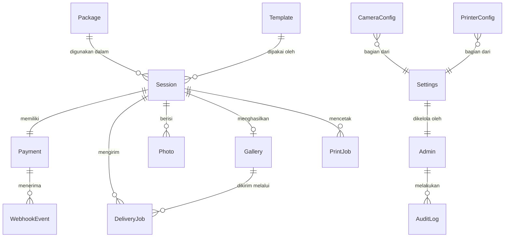

# MINJAPHOTOBOOTH — DATABASE SCHEMA DOCUMENT

**Versi:** 2.0  
**Terakhir diperbarui:** 2026-10-17  
**Status:** Draft — Menunggu Review  
**ORM:** Prisma 6  
**Primary Database:** PostgreSQL 16  
**Local Cache:** SQLite (better-sqlite3, dikelola di luar Prisma)  

---

## 1. Entity-Relationship Diagram



---

## 2. Prisma Schema (PostgreSQL)

```prisma
// prisma/schema.prisma

generator client {
  provider = "prisma-client-js"
}

datasource db {
  provider = "postgresql"
  url      = env("DATABASE_URL")
}

// ============================================================
// 1. Admin — Satu admin per instalasi (singleton)
// ============================================================
model Admin {
  id              String   @id @default(cuid())
  pinHash         String   @map("pin_hash")     // Argon2id hash
  failedAttempts  Int      @default(0) @map("failed_attempts")
  lockedUntil     DateTime? @map("locked_until")
  lastLoginAt     DateTime? @map("last_login_at")
  createdAt       DateTime @default(now()) @map("created_at")
  updatedAt       DateTime @updatedAt @map("updated_at")

  auditLogs       AuditLog[]

  @@map("admins")
}

// ============================================================
// 2. Settings — Konfigurasi global booth (singleton)
// ============================================================
model Settings {
  id                       String   @id @default(cuid())
  
  // Branding (publik)
  boothName                String   @default("MinjaPhotobooth") @map("booth_name")
  brandTitle               String   @default("Minja Photobooth") @map("brand_title")
  welcomeText              String   @default("Selamat datang!") @map("welcome_text")
  primaryColor             String   @default("#6C5CE7") @map("primary_color")
  secondaryColor           String   @default("#A29BFE") @map("secondary_color")
  logoUrl                  String?  @map("logo_url")
  wallpaperUrl             String?  @map("wallpaper_url")
  attractVideoUrl          String?  @map("attract_video_url")
  
  // Operasional
  retentionHours           Int      @default(48) @map("retention_hours")
  maxSessionTimeoutSeconds Int      @default(600) @map("max_session_timeout_seconds")
  paymentTimeoutSeconds    Int      @default(300) @map("payment_timeout_seconds")
  autoResetSeconds         Int      @default(30) @map("auto_reset_seconds")
  maintenanceMode          Boolean  @default(false) @map("maintenance_mode")
  
  // Feature flags
  emailDeliveryEnabled     Boolean  @default(true) @map("email_delivery_enabled")
  galleryEnabled           Boolean  @default(true) @map("gallery_enabled")
  
  // Hardware references
  selectedCameraId         String?  @map("selected_camera_id")
  selectedPrinterName      String?  @map("selected_printer_name")
  
  createdAt                DateTime @default(now()) @map("created_at")
  updatedAt                DateTime @updatedAt @map("updated_at")

  @@map("settings")
}

// ============================================================
// 3. Package — Paket sesi pelanggan
// ============================================================
model Package {
  id                   String   @id @default(cuid())
  name                 String
  description          String   @default("")
  price                Int      // Rupiah (contoh: 35000)
  durationSeconds      Int      @map("duration_seconds")
  maxShots             Int      @map("max_shots")
  maxSelections        Int      @map("max_selections")
  defaultPrints        Int      @map("default_prints")
  additionalPrintPrice Int      @default(0) @map("additional_print_price")
  sortOrder            Int      @default(0) @map("sort_order")
  isActive             Boolean  @default(true) @map("is_active")
  createdAt            DateTime @default(now()) @map("created_at")
  updatedAt            DateTime @updatedAt @map("updated_at")

  sessions             Session[]

  @@map("packages")
}

// ============================================================
// 4. Template — Template foto 4R
// ============================================================
model Template {
  id              String   @id @default(cuid())
  name            String
  thumbnailUrl    String   @map("thumbnail_url")
  frameOverlayUrl String   @map("frame_overlay_url")
  orientation     String   @default("portrait") // "portrait" | "landscape"
  slotsCount      Int      @map("slots_count")
  slots           Json     // Array<{index, x, y, width, height, rotation}>
  isActive        Boolean  @default(true) @map("is_active")
  createdAt       DateTime @default(now()) @map("created_at")
  updatedAt       DateTime @updatedAt @map("updated_at")

  sessions        Session[]

  @@map("templates")
}

// ============================================================
// 5. Session — Sesi pelanggan
// ============================================================
model Session {
  id                   String       @id @default(cuid())
  packageId            String       @map("package_id")
  templateId           String?      @map("template_id")
  state                SessionState @default(AWAITING_PAYMENT)
  
  // Harga (dikalkulasi oleh backend saat sesi dibuat)
  basePrice            Int          @map("base_price")
  additionalPrints     Int          @default(0) @map("additional_prints")
  additionalPrintCost  Int          @default(0) @map("additional_print_cost")
  totalPrice           Int          @map("total_price")
  
  // Batas (disalin dari paket saat sesi dibuat)
  maxShots             Int          @map("max_shots")
  maxSelections        Int          @map("max_selections")
  totalPrints          Int          @map("total_prints")
  durationSeconds      Int          @map("duration_seconds")
  
  // Statistik aktual
  shotsTaken           Int          @default(0) @map("shots_taken")
  photosSelected       Int          @default(0) @map("photos_selected")
  photosPrinted        Int          @default(0) @map("photos_printed")
  
  // Timestamps
  cancelReason         String?      @map("cancel_reason")
  expiresAt            DateTime     @map("expires_at")
  completedAt          DateTime?    @map("completed_at")
  createdAt            DateTime     @default(now()) @map("created_at")
  updatedAt            DateTime     @updatedAt @map("updated_at")

  // Relations
  package              Package      @relation(fields: [packageId], references: [id])
  template             Template?    @relation(fields: [templateId], references: [id])
  payment              Payment?
  photos               Photo[]
  gallery              Gallery?
  printJobs            PrintJob[]
  deliveryJobs         DeliveryJob[]

  @@index([state])
  @@index([createdAt])
  @@map("sessions")
}

enum SessionState {
  AWAITING_PAYMENT
  PAYMENT_CONFIRMED
  CAPTURE_ACTIVE
  PHOTO_REVIEW
  PHOTO_EDITING
  RENDERING
  PRINTING
  SHARING
  COMPLETED
  CANCELLED
  EXPIRED
}

// ============================================================
// 6. Payment — Transaksi pembayaran Midtrans
// ============================================================
model Payment {
  id                 String        @id @default(cuid())
  sessionId          String        @unique @map("session_id")
  orderId            String        @unique @map("order_id")   // MINJA-YYYYMMDD-SEQ
  grossAmount        Int           @map("gross_amount")
  paymentType        String        @default("qris") @map("payment_type")
  transactionStatus  PaymentStatus @default(pending) @map("transaction_status")
  qrString           String?       @map("qr_string")   // EMVCo QRIS string
  qrImageUrl         String?       @map("qr_image_url")
  midtransId         String?       @map("midtrans_id")  // transaction_id dari Midtrans
  isVerified         Boolean       @default(false) @map("is_verified")
  
  expiryTime         DateTime      @map("expiry_time")
  settlementTime     DateTime?     @map("settlement_time")
  createdAt          DateTime      @default(now()) @map("created_at")
  updatedAt          DateTime      @updatedAt @map("updated_at")

  // Relations
  session            Session       @relation(fields: [sessionId], references: [id])
  webhookEvents      WebhookEvent[]

  @@index([orderId])
  @@index([transactionStatus])
  @@map("payments")
}

enum PaymentStatus {
  pending
  settlement
  expire
  cancel
  deny
  refund
}

// ============================================================
// 7. Photo — Metadata foto per sesi
// ============================================================
model Photo {
  id              String   @id @default(cuid())
  sessionId       String   @map("session_id")
  shotNumber      Int      @map("shot_number")
  localFilePath   String   @map("local_file_path")
  originalFilename String  @map("original_filename")
  fileSizeBytes   Int      @map("file_size_bytes")
  width           Int
  height          Int
  mimeType        String   @map("mime_type")        // "image/jpeg" | "image/png"
  storageKey      String?  @map("storage_key")      // Key di object storage
  storageUrl      String?  @map("storage_url")      // Public/signed URL
  isSelected      Boolean  @default(false) @map("is_selected")
  createdAt       DateTime @default(now()) @map("created_at")

  session         Session  @relation(fields: [sessionId], references: [id])

  @@unique([sessionId, shotNumber])
  @@index([sessionId])
  @@map("photos")
}

// ============================================================
// 8. CameraConfig — Konfigurasi kamera tersedia
// ============================================================
model CameraConfig {
  id          String   @id @default(cuid())
  deviceId    String   @unique @map("device_id")
  name        String
  type        String   // "webcam" | "virtual_webcam" | "canon_dslr"
  isActive    Boolean  @default(true) @map("is_active")
  settings    Json?    // Pengaturan khusus per kamera (resolusi, exposure, dll.)
  createdAt   DateTime @default(now()) @map("created_at")
  updatedAt   DateTime @updatedAt @map("updated_at")

  @@map("camera_configs")
}

// ============================================================
// 9. PrinterConfig — Konfigurasi printer tersedia
// ============================================================
model PrinterConfig {
  id             String   @id @default(cuid())
  printerName    String   @unique @map("printer_name")
  displayName    String   @map("display_name")
  paperSize      String   @default("4R") @map("paper_size")
  isDefault      Boolean  @default(false) @map("is_default")
  isActive       Boolean  @default(true) @map("is_active")
  settings       Json?    // Pengaturan khusus (margin, borderless, orientasi)
  createdAt      DateTime @default(now()) @map("created_at")
  updatedAt      DateTime @updatedAt @map("updated_at")

  @@map("printer_configs")
}

// ============================================================
// 10. PrintJob — Antrean cetak
// ============================================================
model PrintJob {
  id              String         @id @default(cuid())
  sessionId       String         @map("session_id")
  imageFilePath   String         @map("image_file_path")
  printerName     String         @map("printer_name")
  copies          Int            @default(1)
  status          PrintJobStatus @default(queued)
  errorMessage    String?        @map("error_message")
  isReprint       Boolean        @default(false) @map("is_reprint")
  reprintReason   String?        @map("reprint_reason")
  createdAt       DateTime       @default(now()) @map("created_at")
  updatedAt       DateTime       @updatedAt @map("updated_at")

  session         Session        @relation(fields: [sessionId], references: [id])

  @@index([sessionId])
  @@index([status])
  @@map("print_jobs")
}

enum PrintJobStatus {
  queued
  printing
  completed
  failed
}

// ============================================================
// 11. Gallery — Galeri privat pelanggan
// ============================================================
model Gallery {
  id           String        @id @default(cuid())
  sessionId    String        @unique @map("session_id")
  token        String        @unique   // nanoid 32 chars (crypto-secure)
  expiresAt    DateTime      @map("expires_at")
  accessCount  Int           @default(0) @map("access_count")
  createdAt    DateTime      @default(now()) @map("created_at")

  session      Session       @relation(fields: [sessionId], references: [id])
  deliveryJobs DeliveryJob[]

  @@index([token])
  @@index([expiresAt])
  @@map("galleries")
}

// ============================================================
// 12. DeliveryJob — Antrean pengiriman digital
// ============================================================
model DeliveryJob {
  id           String             @id @default(cuid())
  sessionId    String             @map("session_id")
  galleryId    String?            @map("gallery_id")
  channel      DeliveryChannel    @default(email)
  email        String?            @map("email")
  status       DeliveryJobStatus  @default(queued)
  messageId    String?            @map("message_id")     // ID dari Layanan Email SMTP
  retryCount   Int                @default(0) @map("retry_count")
  maxRetries   Int                @default(3) @map("max_retries")
  errorMessage String?            @map("error_message")
  nextRetryAt  DateTime?          @map("next_retry_at")
  sentAt       DateTime?          @map("sent_at")
  createdAt    DateTime           @default(now()) @map("created_at")
  updatedAt    DateTime           @updatedAt @map("updated_at")

  session      Session            @relation(fields: [sessionId], references: [id])
  gallery      Gallery?           @relation(fields: [galleryId], references: [id])

  @@index([status])
  @@index([sessionId])
  @@map("delivery_jobs")
}

enum DeliveryChannel {
  email
  qr_gallery
}

enum DeliveryJobStatus {
  queued
  sending
  sent
  delivered
  failed
}

// ============================================================
// 13. WebhookEvent — Catatan webhook Midtrans masuk
// ============================================================
model WebhookEvent {
  id                String   @id @default(cuid())
  paymentId         String   @map("payment_id")
  orderId           String   @map("order_id")
  transactionStatus String   @map("transaction_status")
  statusCode        String   @map("status_code")
  signatureValid    Boolean  @map("signature_valid")
  rawPayload        Json     @map("raw_payload")
  processedAt       DateTime @default(now()) @map("processed_at")
  createdAt         DateTime @default(now()) @map("created_at")

  payment           Payment  @relation(fields: [paymentId], references: [id])

  @@index([orderId])
  @@map("webhook_events")
}

// ============================================================
// 14. AuditLog — Catatan tindakan admin
// ============================================================
model AuditLog {
  id         String   @id @default(cuid())
  adminId    String?  @map("admin_id")
  action     String   // "ADMIN_LOGIN", "SETTINGS_UPDATED", "PACKAGE_CREATED", dll.
  details    Json?    // Detail perubahan (before/after values)
  ipAddress  String?  @map("ip_address")
  createdAt  DateTime @default(now()) @map("created_at")

  admin      Admin?   @relation(fields: [adminId], references: [id])

  @@index([action])
  @@index([createdAt])
  @@map("audit_logs")
}
```

---

## 3. Daftar Audit Log Actions

| Action | Deskripsi | Detail yang dicatat |
|--------|-----------|---------------------|
| `ADMIN_SETUP` | Inisialisasi admin pertama | - |
| `ADMIN_LOGIN` | Login berhasil | IP address |
| `ADMIN_LOGIN_FAILED` | Login gagal | IP, failedAttempts |
| `ADMIN_LOCKED` | Akun terkunci setelah 5x gagal | lockDuration |
| `ADMIN_LOGOUT` | Logout | - |
| `PIN_CHANGED` | PIN admin diubah | - (tidak mencatat PIN) |
| `SETTINGS_UPDATED` | Pengaturan diperbarui | field yang berubah (before/after) |
| `PACKAGE_CREATED` | Paket baru dibuat | packageId, name, price |
| `PACKAGE_UPDATED` | Paket diperbarui | packageId, fields changed |
| `PACKAGE_DEACTIVATED` | Paket dinonaktifkan | packageId |
| `TEMPLATE_CREATED` | Template baru dibuat | templateId, name |
| `TEMPLATE_UPDATED` | Template diperbarui | templateId |
| `TEMPLATE_DEACTIVATED` | Template dinonaktifkan | templateId |
| `PRINT_REPRINT` | Cetak ulang oleh admin | orderId, reason |
| `REPORT_EXPORTED` | Laporan CSV diekspor | dateRange |

---

## 4. SQLite Schema (Desktop Local Cache)

SQLite dikelola di luar Prisma, menggunakan `better-sqlite3` secara langsung di Electron Main Process. Schema berikut adalah definisi DDL yang dieksekusi saat aplikasi pertama kali dijalankan.

```sql
-- Konfigurasi booth lokal (cache dari backend)
CREATE TABLE IF NOT EXISTS local_settings (
  key   TEXT PRIMARY KEY,
  value TEXT NOT NULL,
  updated_at TEXT NOT NULL DEFAULT (datetime('now'))
);

-- Cache paket aktif (disinkron dari backend)
CREATE TABLE IF NOT EXISTS local_packages (
  id                    TEXT PRIMARY KEY,
  name                  TEXT NOT NULL,
  description           TEXT DEFAULT '',
  price                 INTEGER NOT NULL,
  duration_seconds      INTEGER NOT NULL,
  max_shots             INTEGER NOT NULL,
  max_selections        INTEGER NOT NULL,
  default_prints        INTEGER NOT NULL,
  additional_print_price INTEGER DEFAULT 0,
  sort_order            INTEGER DEFAULT 0,
  synced_at             TEXT NOT NULL DEFAULT (datetime('now'))
);

-- Sesi aktif/pending lokal
CREATE TABLE IF NOT EXISTS local_sessions (
  id                TEXT PRIMARY KEY,
  package_id        TEXT NOT NULL,
  state             TEXT NOT NULL DEFAULT 'AWAITING_PAYMENT',
  total_price       INTEGER NOT NULL,
  shots_taken       INTEGER DEFAULT 0,
  photos_selected   INTEGER DEFAULT 0,
  created_at        TEXT NOT NULL DEFAULT (datetime('now')),
  updated_at        TEXT NOT NULL DEFAULT (datetime('now'))
);

-- Antrean cetak lokal
CREATE TABLE IF NOT EXISTS local_print_queue (
  id              TEXT PRIMARY KEY,
  session_id      TEXT NOT NULL,
  image_file_path TEXT NOT NULL,
  printer_name    TEXT NOT NULL,
  copies          INTEGER DEFAULT 1,
  status          TEXT NOT NULL DEFAULT 'queued',
  error_message   TEXT,
  created_at      TEXT NOT NULL DEFAULT (datetime('now')),
  FOREIGN KEY (session_id) REFERENCES local_sessions(id)
);

-- Antrean sinkronisasi ke backend (Outbox Pattern)
CREATE TABLE IF NOT EXISTS sync_outbox (
  id           INTEGER PRIMARY KEY AUTOINCREMENT,
  entity_type  TEXT NOT NULL,            -- 'session', 'photo', 'print_job'
  entity_id    TEXT NOT NULL,
  action       TEXT NOT NULL,            -- 'create', 'update', 'delete'
  payload      TEXT NOT NULL,            -- JSON serialized data
  status       TEXT NOT NULL DEFAULT 'pending',  -- 'pending', 'syncing', 'synced', 'failed'
  retry_count  INTEGER DEFAULT 0,
  last_error   TEXT,
  created_at   TEXT NOT NULL DEFAULT (datetime('now')),
  synced_at    TEXT
);

CREATE INDEX IF NOT EXISTS idx_sync_outbox_status ON sync_outbox(status);
```

---

## 5. Kebijakan Retensi Data

| Data | Retensi Default | Dapat Diubah Admin | Mekanisme Penghapusan |
|------|----------------|--------------------|-----------------------|
| Foto di object storage | 48 jam | Ya (1-720 jam) | Cron job backend atau S3 lifecycle rule |
| Gallery token | 48 jam | Ya (sesuai retentionHours) | Cron job: hapus gallery record + foto terkait |
| Foto lokal di mesin | Setelah sesi selesai + 1 jam | Tidak | Electron cleanup worker |
| Transaksi di PostgreSQL | Permanen | Tidak | Tidak dihapus (untuk audit) |
| Audit log | Permanen | Tidak | Tidak dihapus |
| Webhook events | 90 hari | Tidak | Cron job backend |
| SQLite sync outbox | Setelah synced + 7 hari | Tidak | Electron cleanup worker |

---

## 6. Indeks dan Performa

Indeks yang sudah didefinisikan dalam Prisma schema:

| Tabel | Kolom | Tujuan |
|-------|-------|--------|
| `sessions` | `state` | Pencarian sesi aktif cepat |
| `sessions` | `createdAt` | Laporan berdasarkan tanggal |
| `payments` | `orderId` (unique) | Lookup cepat untuk webhook & polling |
| `payments` | `transactionStatus` | Filter laporan |
| `photos` | `sessionId` | Ambil foto per sesi |
| `photos` | `sessionId + shotNumber` (unique) | Mencegah duplikat shot |
| `print_jobs` | `sessionId` | Ambil job cetak per sesi |
| `print_jobs` | `status` | Monitoring antrean |
| `galleries` | `token` (unique) | Lookup cepat dari QR code |
| `galleries` | `expiresAt` | Cron cleanup |
| `delivery_jobs` | `status` | Monitoring antrean |
| `webhook_events` | `orderId` | Lookup untuk idempotency check |
| `audit_logs` | `action` | Filter berdasarkan jenis tindakan |
| `audit_logs` | `createdAt` | Laporan berdasarkan tanggal |
