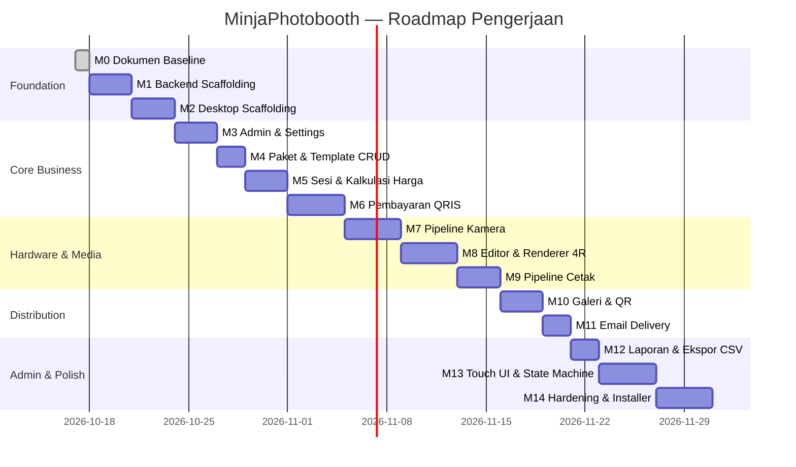

# MINJAPHOTOBOOTH — MILESTONES & ROADMAP

**Versi:** 2.0  
**Terakhir diperbarui:** 2026-10-17  
**Status:** Draft — Menunggu Review  

---

## 1. Prinsip Pengerjaan

1. **Satu milestone per satu waktu.** Jangan mulai milestone berikutnya sebelum milestone saat ini lolos pengujian.
2. **Workflow per milestone:** Inspect → Plan → Implement → Test → Review → Document → Commit.
3. **Setiap milestone harus menghasilkan** kode yang bisa di-build, test yang lolos, dan dokumentasi yang diperbarui.
4. **Jangan membuat fungsi perangkat palsu.** Mock adapter hanya untuk testing, bukan untuk simulasi perangkat.
5. **Jangan menimpa seluruh repository.** Perubahan dilakukan secara inkremental.

---

## 2. Roadmap Milestone



---

## 3. Detail per Milestone

---

### M0 — Dokumen Baseline ✅ SELESAI

**Deliverables:**
- [x] `docs/PRD.md` — Product Requirements Document
- [x] `docs/ARCHITECTURE.md` — Software Architecture
- [x] `docs/API_CONTRACT.md` — API Contract Specification
- [x] `docs/DATABASE_SCHEMA.md` — Database Schema
- [x] `docs/SECURITY.md` — Security Document
- [x] `docs/TEST_PLAN.md` — Test Plan
- [x] `docs/MILESTONES.md` — Roadmap (dokumen ini)
- [x] `.gitignore`, `README.md`
- [x] Git repository diinisialisasi

**Kriteria Lulus:** Review dokumen lengkap dan disetujui.

---

### M1 — Backend Scaffolding

**Tujuan:** Setup proyek backend Fastify + Prisma + PostgreSQL yang bisa di-build dan di-test.

**Deliverables:**
- [ ] `server/` directory structure sesuai ARCHITECTURE.md
- [ ] `package.json` dengan dependencies (Fastify, Prisma, Zod, Vitest, dll.)
- [ ] `tsconfig.json` konfigurasi TypeScript strict
- [ ] `prisma/schema.prisma` sesuai DATABASE_SCHEMA.md
- [ ] `.env.example` dengan daftar variabel
- [ ] `src/config/env.ts` — Loader & validator environment variables
- [ ] `src/app.ts` — Fastify instance dengan plugin registration
- [ ] `src/server.ts` — Entry point
- [ ] `src/middleware/error.middleware.ts` — Global error handler
- [ ] `src/types/common.types.ts` — ApiResponse, ApiError, ErrorCode
- [ ] `GET /api/system/health` endpoint berfungsi
- [ ] Prisma migration berhasil
- [ ] Vitest berjalan (minimal 1 test health check)

**Perintah Verifikasi:**
```bash
cd server
npm install
npx prisma migrate dev
npm run build        # TypeScript compile berhasil
npm run test         # Health check test lolos
npm run dev          # Server berjalan di localhost:3000
curl http://localhost:3000/api/system/health  # {"success":true,"data":{"status":"ok"}}
```

**Kriteria Lulus:** `npm run build` dan `npm run test` berhasil tanpa error.

---

### M2 — Desktop Scaffolding

**Tujuan:** Setup Electron + Vite + React + TypeScript yang bisa menampilkan window dan berkomunikasi dengan backend.

**Deliverables:**
- [ ] `desktop/` directory structure
- [ ] Electron main process dengan `BrowserWindow`
- [ ] Preload script dengan `contextBridge`
- [ ] React app (Vite) dengan halaman "Hello MinjaPhotobooth"
- [ ] SQLite lokal diinisialisasi (`better-sqlite3`)
- [ ] HTTP client di Electron Main untuk berkomunikasi ke backend
- [ ] IPC bridge: renderer bisa memanggil health check ke backend melalui main process
- [ ] Konfigurasi keamanan renderer (`nodeIntegration: false`, `contextIsolation: true`)

**Perintah Verifikasi:**
```bash
cd desktop
npm install
npm run build
npm run dev          # Window Electron terbuka, menampilkan React app
```

**Kriteria Lulus:** Window Electron terbuka, React app terlihat, IPC health check ke backend berhasil.

---

### M3 — Admin Authentication & Settings

**Tujuan:** Admin bisa setup PIN, login, logout, dan mengelola pengaturan booth.

**Deliverables:**
- [ ] `POST /api/admin/setup` — Inisialisasi PIN pertama
- [ ] `POST /api/admin/login` — Login dengan Argon2id verification
- [ ] `POST /api/admin/logout` — Logout
- [ ] `PUT /api/admin/pin` — Ubah PIN
- [ ] `GET /api/public/settings` — Pengaturan publik
- [ ] `GET /api/admin/settings` — Pengaturan admin (JWT required)
- [ ] `PUT /api/admin/settings` — Update pengaturan
- [ ] Auth middleware (JWT verification)
- [ ] Brute force lockout (5x gagal → 10 menit kunci)
- [ ] Audit log untuk operasi admin
- [ ] Test cases A01-A15, S01-S07

**Perintah Verifikasi:**
```bash
npm run test -- --grep "admin|settings|auth"
```

**Kriteria Lulus:** Seluruh test admin & settings lolos. PIN ter-hash di database.

---

### M4 — Paket & Template CRUD

**Tujuan:** Admin bisa membuat, mengedit, dan menonaktifkan paket sesi dan template foto.

**Deliverables:**
- [ ] CRUD endpoints untuk Package (5 endpoint)
- [ ] CRUD endpoints untuk Template (5 endpoint)
- [ ] Validasi input (Zod schemas)
- [ ] Soft delete (deactivate, bukan hapus)
- [ ] Audit log untuk setiap perubahan
- [ ] Test cases P01-P09, T01-T06

**Perintah Verifikasi:**
```bash
npm run test -- --grep "package|template"
```

**Kriteria Lulus:** CRUD berfungsi, validasi mencegah data tidak valid, paket nonaktif tidak muncul di endpoint publik.

---

### M5 — Sesi & Kalkulasi Harga

**Tujuan:** Desktop bisa membuat sesi baru dengan harga yang dihitung oleh backend. State machine sesi berfungsi.

**Deliverables:**
- [ ] `POST /api/sessions` — Buat sesi (harga dihitung server-side)
- [ ] `GET /api/sessions/:id` — Detail sesi
- [ ] `GET /api/sessions/active` — Sesi aktif saat ini
- [ ] `PATCH /api/sessions/:id/state` — Transisi state
- [ ] `POST /api/sessions/:id/complete` — Selesaikan sesi
- [ ] `POST /api/sessions/:id/cancel` — Batalkan sesi
- [ ] Price engine service
- [ ] State machine validation (transisi yang valid/tidak valid)
- [ ] Session timeout worker
- [ ] Test cases SS01-SS11

**Perintah Verifikasi:**
```bash
npm run test -- --grep "session|price"
```

**Kriteria Lulus:**
- `totalPrice = package.price + (additionalPrints × additionalPrintPrice)` — dihitung oleh backend.
- Transisi state tidak valid ditolak.
- Sesi kadaluwarsa otomatis setelah timeout.

---

### M6 — Pembayaran QRIS (Midtrans)

**Tujuan:** Transaksi pembayaran QRIS bisa dibuat, status bisa dipantau, dan webhook diproses secara idempoten.

**Deliverables:**
- [ ] `POST /api/payments` — Buat transaksi QRIS
- [ ] `GET /api/payments/:orderId/status` — Polling status
- [ ] `POST /api/webhooks/midtrans` — Webhook handler
- [ ] Midtrans adapter (mock + real implementation)
- [ ] Signature SHA512 verification
- [ ] Idempotency guard (webhook duplikat tidak menyebabkan efek ganda)
- [ ] WebhookEvent logging
- [ ] Polling reconciler
- [ ] Test cases PM01-PM12

**Perintah Verifikasi:**
```bash
npm run test -- --grep "payment|webhook"
```

**Kriteria Lulus:**
- Webhook dengan signature valid → sesi aktif.
- Webhook dengan signature salah → ditolak.
- Webhook duplikat → tidak ada efek ganda.
- Sesi **tidak pernah** aktif tanpa `settlement + isVerified`.

**Pengujian yang belum dapat dilakukan tanpa kredensial:**
- MA05: Sandbox transaction (memerlukan akun Midtrans sandbox).
- MA06: Production transaction (memerlukan akun Midtrans production).

---

### M7 — Pipeline Kamera

**Tujuan:** Desktop bisa mendeteksi, menghubungkan, dan mengambil foto dari webcam. Adapter Canon EOS 600D didesain.

**Deliverables:**
- [ ] Camera adapter interface (TypeScript)
- [ ] WebcamAdapter implementation (escapi / node-webcam)
- [ ] MockCameraAdapter untuk testing
- [ ] CanonDSLRAdapter structure (implementasi bergantung pada EDSDK)
- [ ] IPC channels: `camera:list`, `camera:connect`, `camera:capture`, dll.
- [ ] Live preview streaming (main → renderer via IPC)
- [ ] Photo metadata dikirim ke backend (`POST /api/photos`)
- [ ] Test cases PH01-PH07

**Perintah Verifikasi:**
```bash
npm run test -- --grep "camera|photo"
```

**Pengujian yang belum dapat dilakukan tanpa perangkat:**
- HW01-HW05: Memerlukan webcam USB dan/atau Canon EOS 600D.

---

### M8 — Editor Foto & Renderer 4R

**Tujuan:** Pelanggan bisa mengedit foto (crop, filter, template) dan sistem merender output 300 DPI.

**Deliverables:**
- [ ] React photo editor component (crop, rotate, brightness, contrast)
- [ ] Filter presets (B&W, sepia, vintage, cool, warm)
- [ ] Template overlay renderer (posisi foto dalam slot template)
- [ ] Sticker overlay
- [ ] Sharp-based 4R compositor di Electron Main (1200x1800px, 300 DPI)
- [ ] Preview thumbnail generator
- [ ] IPC channels: `editor:render`, `editor:preview`

**Kriteria Lulus:**
- Output file = 1200×1800 px atau 1800×1200 px.
- DPI metadata = 300.
- Rendering tidak freeze UI (berjalan di background worker).

---

### M9 — Pipeline Cetak 4R

**Tujuan:** Foto yang sudah dirender bisa dicetak ke printer 4R melalui Windows Spooler.

**Deliverables:**
- [ ] Printer adapter interface
- [ ] WindowsSpoolerAdapter (pdf-to-printer atau win32 API)
- [ ] MockPrinterAdapter untuk testing
- [ ] Print queue management di SQLite lokal
- [ ] PrintJob record di backend (`POST /api/print-jobs`)
- [ ] Status tracking
- [ ] Test print dari admin panel
- [ ] Admin reprint dengan audit log

**Pengujian yang belum dapat dilakukan tanpa perangkat:**
- HW06-HW08: Memerlukan printer foto 4R.

---

### M10 — Galeri Privat & QR Code

**Tujuan:** Pelanggan bisa memindai QR code untuk mengakses galeri foto privat dari smartphone.

**Deliverables:**
- [ ] `POST /api/gallery` — Buat galeri + generate QR
- [ ] `GET /api/gallery/:token` — Akses galeri publik
- [ ] Storage adapter (upload foto ke S3/R2)
- [ ] Signed URL generation untuk download
- [ ] QR code generator (qrcode npm package)
- [ ] Retensi cron job (hapus galeri kadaluwarsa)
- [ ] Halaman web galeri (bisa standalone atau SSR sederhana)
- [ ] Test cases G01-G06

**Perintah Verifikasi:**
```bash
npm run test -- --grep "gallery|storage"
```

**Kriteria Lulus:** QR code bisa dipindai dari HP, galeri terbuka di browser, foto bisa diunduh.

---

### M11 — Email Delivery

**Tujuan:** Sistem bisa mengirim tautan galeri ke pelanggan via Layanan Email (SMTP / Nodemailer).

**Deliverables:**
- [ ] `POST /api/sessions/:sessionId/email` — Kirim soft file via email
- [ ] `GET /api/delivery/:id/status` — Status pengiriman
- [ ] Email Service (mock simulation + real SMTP nodemailer transporter)
- [ ] Delivery queue dengan retry mechanism
- [ ] Validasi format email RFC
- [ ] Test cases D01-D06

**Pengujian yang belum dapat dilakukan tanpa kredensial:**
- EM03: Memerlukan akun SMTP aktif (Gmail app password / custom domain SMTP).

---

### M12 — Laporan & Ekspor CSV

**Tujuan:** Admin bisa melihat ringkasan pendapatan dan mengekspor laporan transaksi.

**Deliverables:**
- [ ] `GET /api/admin/reports/summary` — Ringkasan
- [ ] `GET /api/admin/reports/transactions` — Daftar transaksi
- [ ] `GET /api/admin/reports/export/csv` — Ekspor CSV
- [ ] `GET /api/admin/audit-log` — Log audit
- [ ] Test cases R01-R06, AL01-AL04

**Kriteria Lulus:** Laporan menampilkan data yang benar. CSV bisa diunduh dan dibuka di Excel.

---

### M13 — Touch UI & State Machine (Desktop)

**Tujuan:** Antarmuka pelanggan lengkap dari attract screen hingga halaman terima kasih.

**Deliverables:**
- [ ] Attract screen (idle) dengan animasi/video
- [ ] Halaman pilih paket
- [ ] Halaman pembayaran QRIS (tampilkan QR, countdown timer)
- [ ] Halaman sesi kamera (live preview, countdown shutter)
- [ ] Halaman review foto (grid thumbnail, pilih/hapus)
- [ ] Halaman editor foto (crop, filter, template, sticker)
- [ ] Halaman cetak & share (progress cetak, QR galeri, input nomor WA)
- [ ] Halaman terima kasih (auto-reset timer)
- [ ] Virtual numpad untuk input nomor WA
- [ ] State machine orchestration (React state management)
- [ ] Hidden admin access (tap logo 5x)
- [ ] Admin panel pages (CRUD, laporan, konfigurasi)
- [ ] Responsif untuk touchscreen landscape (1920x1080)

**Kriteria Lulus:** Pelanggan bisa menyelesaikan seluruh alur dari mulai hingga selesai tanpa keyboard/mouse fisik.

---

### M14 — Hardening & Installer

**Tujuan:** Aplikasi siap produksi dengan installer Windows, auto-update, dan penanganan error.

**Deliverables:**
- [ ] Windows installer (.exe) menggunakan electron-builder
- [ ] Auto-updater (electron-updater)
- [ ] `GET /api/system/version` — Cek update
- [ ] Crash recovery (sesi terakhir bisa dilanjutkan/direset)
- [ ] Error boundary React (tampilan error ramah pengguna)
- [ ] Logging terstruktur (Pino)
- [ ] Kiosk mode (fullscreen, tanpa menu bar, tanpa DevTools)
- [ ] Cleanup worker (hapus file sementara)
- [ ] Offline sync worker
- [ ] Performance testing (8 jam operasi tanpa memory leak)
- [ ] Smoke test produksi end-to-end

**Kriteria Lulus:**
- Installer berjalan bersih di Windows 10/11 baru.
- Update tidak menghapus database, konfigurasi, atau foto.
- Booth berjalan 8 jam tanpa crash atau memory leak.

---

## 4. Daftar Risiko per Milestone

| Milestone | Risiko | Dampak | Mitigasi |
|-----------|--------|--------|----------|
| M1 | PostgreSQL belum terpasang di mesin dev | Build gagal | Panduan instalasi di README, atau gunakan Docker |
| M6 | Midtrans sandbox tidak dapat diakses | Integrasi pembayaran tidak bisa diuji | Gunakan mock adapter, uji real saat kredensial tersedia |
| M7 | Canon EOS 600D tidak tersedia | DSLR adapter tidak bisa diuji | Gunakan webcam adapter dulu, DSLR adapter diimplementasikan dengan mock |
| M7 | EDSDK memerlukan lisensi Canon | Library tidak bisa digunakan | Investigasi gphoto2 sebagai alternatif open-source |
| M9 | Printer 4R tidak tersedia | Print job tidak bisa diuji | Gunakan mock adapter, uji manual saat printer tersedia |
| M10 | Object storage belum dikonfigurasi | Upload foto gagal | Gunakan mock adapter atau local file storage sementara |
| M11 | Kredensial SMTP belum dikonfigurasi | Pengiriman email gagal | Gunakan mock simulation, uji saat kredensial SMTP tersedia |
| M13 | Layar sentuh tidak tersedia | Touch interaction tidak bisa diuji | Gunakan mouse untuk simulasi, uji real saat touchscreen tersedia |
| M14 | Code signing certificate tidak ada | Installer memunculkan warning Windows SmartScreen | Beli certificate atau informasikan ke pengguna untuk bypass |

---

## 5. Dokumen Referensi

| Dokumen | Path | Deskripsi |
|---------|------|-----------|
| PRD | [docs/PRD.md](PRD.md) | Kebutuhan bisnis dan alur pelanggan |
| Architecture | [docs/ARCHITECTURE.md](ARCHITECTURE.md) | Arsitektur sistem dan keputusan desain |
| API Contract | [docs/API_CONTRACT.md](API_CONTRACT.md) | Spesifikasi 41 endpoint REST |
| Database Schema | [docs/DATABASE_SCHEMA.md](DATABASE_SCHEMA.md) | 14 model Prisma + SQLite DDL |
| Security | [docs/SECURITY.md](SECURITY.md) | Keamanan, autentikasi, dan manajemen secret |
| Test Plan | [docs/TEST_PLAN.md](TEST_PLAN.md) | 85+ test cases dan strategi pengujian |
