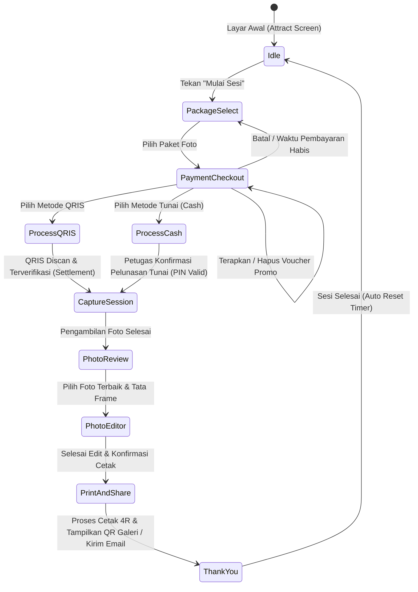

# MINJAPHOTOBOOTH — PRODUCT REQUIREMENTS DOCUMENT

**Versi:** 1.0  
**Platform:** Windows 10/11 64-bit  
**Jenis aplikasi:** Self-service photobooth desktop  
**Status:** Baseline Disetujui  
**Nama produk:** MinjaPhotobooth

---

## 1. Tujuan Produk

MinjaPhotobooth adalah aplikasi photobooth mandiri (self-service) yang dirancang khusus untuk lingkungan Windows. Aplikasi memungkinkan pelanggan untuk:
1. Memilih dan membeli paket sesi foto secara mandiri.
2. Menerapkan kode voucher promo (diskon persentase maupun potongan tetap).
3. Membayar secara non-tunai melalui QRIS (Midtrans) atau tunai (cash) melalui konfirmasi petugas kasir.
4. Mengambil foto dengan panduan live preview interaktif.
5. Memilih, menghapus, dan mengedit hasil foto (frame, filter, sticker, teks).
6. Mencetak foto fisik ukuran 4R (10x15 cm) berkualitas tinggi (300 DPI).
7. Mengunduh soft file foto beresolusi penuh melalui QR code galeri privat.
8. Menerima soft file langsung ke alamat email melalui Layanan Email (SMTP / Nodemailer).

Aplikasi beroperasi secara otomatis tanpa memerlukan operator mendampingi pelanggan sepanjang sesi. Untuk kebutuhan operasional, tersedia **Admin Panel tersembunyi** yang diamankan dengan autentikasi PIN untuk konfigurasi perangkat, tarif, voucher promo, konfirmasi kasir tunai, template, branding, dan audit transaksi.

---

## 2. Target Pengguna

### Pelanggan (Self-Service)
- Berinteraksi langsung melalui layar sentuh (touchscreen) landscape.
- Pengalaman pengguna harus intuitif, cepat, tidak membingungkan, dan minim teks panjang.
- Dapat memasukkan kode voucher untuk potongan harga sebelum bayar.
- Fleksibel memilih pembayaran QRIS otomatis atau membayar tunai kepada petugas kasir booth.
- Memiliki kontrol penuh atas foto yang diambil (retake, pilih foto terbaik).
- Menerima hasil fisik (cetak) dan digital (QR/Email) secara instan.

### Pengelola / Admin & Petugas Kasir
- Membuka panel kontrol melalui gestur/area tersembunyi dengan verifikasi PIN aman.
- Mengelola kupon/voucher diskon: persentase, potongan tetap, masa berlaku, kuota, dan minimal belanja.
- Menerima pembayaran tunai pelanggan: mengonfirmasi via PIN admin, memverifikasi uang diterima, dan menghitung kembalian otomatis.
- Mengatur konfigurasi display: tema, logo, wallpaper, warna, dan teks selamat datang.
- Mengelola paket sesi: durasi waktu, batas foto cetak, dan harga dasar.
- Memantau hardware: kamera (webcam/DSLR), printer 4R, dan kertas.
- Mengakses laporan transaksi lengkap yang memisahkan QRIS, tunai, voucher, status transaksi, dan nama petugas kasir.

---

## 3. Alur Pelanggan (Customer Journey)

1. **Layar Awal (Idle / Attract Screen):** Video/animasi menarik dengan tombol sentuh besar "Mulai Sesi".
2. **Pilih Paket:** Pelanggan memilih jenis sesi, durasi waktu, jumlah cetak bawaan, dan add-on cetak.
3. **Halaman Pembayaran & Voucher:**
   - Pelanggan dapat memasukkan kode voucher promo (persentase dengan batas maksimum atau nominal tetap).
   - Sistem menghitung ulang rincian harga secara dinamis: Subtotal paket, diskon voucher, biaya add-on cetak, dan total tagihan.
   - Pelanggan memilih metode pembayaran: **QRIS (Midtrans)** atau **Tunai (Cash)**.
4. **Penyelesaian Pembayaran:**
   - **QRIS:** QR dinamis tampil di layar; polling otomatis mendeteksi status settlement.
   - **Tunai:** Layar menunggu konfirmasi kasir menampilkan Order ID, paket, rincian voucher, dan total tagihan. Petugas memasukkan PIN admin, input nominal uang fisik yang diterima, dan sistem menghitung uang kembalian.
5. **Sesi Foto (Countdown & Shutter):** Live preview kamera aktif, timer hitung mundur (3.. 2.. 1..), shutter capture, dan audio panduan suara.
6. **Review & Seleksi:** Pelanggan melihat galeri thumbnail sesi dan memilih foto yang akan dimasukkan ke template.
7. **Editor Foto:** Fitur crop, rotasi, filter warna, penambahan frame/template, sticker, dan preview layout cetak.
8. **Finalisasi & Cetak:** Rendering layout resolusi tinggi 4R (1200x1800 px pada 300 DPI), pengiriman job ke antrean printer Windows.
9. **Distribusi Digital:** Tampilan QR Code galeri privat berbatas waktu (misal: 48 jam) dan opsi input email untuk pengiriman otomatis tautan galeri via Layanan Email (SMTP).
10. **Pembersihan & Reset:** Sesi ditutup, file sementara dibersihkan dari memori, dan layar kembali ke status Idle.

---

## 4. Persyaratan Fungsional Detail

### 4.1 Kamera & Imaging
- **Dukungan Perangkat:**
  - Webcam USB standar (UVC).
  - Virtual Webcam (OBS Virtual Camera, vMix, dll).
  - DSLR/Mirrorless melalui adapter modular (Target awal: **Canon EOS 600D**).
- **Fitur Live Preview:**
  - Tampilan live stream halus (minimum 24–30 FPS).
  - Countdown visual interaktif dengan suara bip/shutter.
  - Multi-camera readiness melalui antarmuka `CameraAdapter`.
  - Penanganan status disconnect / reconnection tanpa crash aplikasi.

### 4.2 Editor Foto & Rendering
- **Manipulasi Gambar:** Crop proporsional, rotate 90°, mirror, pengaturan brightness & contrast.
- **Filter Kreatif:** Black & White, Vintage/Sepia, Warm, Cool, Glamour soft.
- **Komposisi:** Penambahan frame template PNG transparan, sticker, dan teks khusus (tanggal, watermark acara).
- **High-Resolution Renderer:**
  - Rendering independen dari resolusi layar monitor.
  - Standar ukuran cetak 4R: rasio 2:3 (1200 x 1800 px atau 1800 x 1200 px pada 300 DPI).
  - Format output: JPEG/PNG lossless sRGB untuk printer dye-sublimation / inkjet.

### 4.3 Paket, Voucher Promo & Perhitungan Biaya
- **Otoritas Perhitungan:** Seluruh validasi voucher, diskon, biaya add-on cetak, dan total harga dihitung secara otoritatif oleh Backend (frontend dilarang menjadi otoritas harga produksi).
- **Struktur Paket:** ID paket, Nama, Harga dasar, Durasi sesi (detik), dan Jumlah cetak default.
- **Mekanisme Voucher / Kode Promo:**
  - Jenis diskon:
    1. **Persentase (`percentage`):** Nilai 1–100% dengan batas maksimum potongan (`maxDiscount`).
    2. **Potongan Tetap (`fixed`):** Nominal potongan tetap (misal: Rp10.000).
  - Validasi ketat:
    - Status aktif voucher.
    - Rentang tanggal masa berlaku (`validFrom` s/d `validUntil`).
    - Kuota penggunaan tersisa (`usedCount < quota`).
    - Nilai transaksi minimum paket (`minTransaction`).
    - Kesesuaian paket foto yang dipilih (`applicablePackages`).
  - Penanganan error kode voucher yang jelas (`INVALID_CODE`, `EXPIRED`, `OUT_OF_QUOTA`, `MIN_TRANSACTION_NOT_MET`, `PACKAGE_NOT_ELIGIBLE`, `INACTIVE`).
- **Opsi Biaya Tambahan (Add-on):** Tambahan lembar cetak fisik (+Rp per lembar).

### 4.4 Metode Pembayaran (QRIS Midtrans & Tunai / Cash)
Pelanggan dapat memilih antara pembayaran mandiri via QRIS atau pembayaran tunai kepada staf kasir:
- **1. QRIS (Midtrans):**
  - Siklus hidup transaksi: `pending`, `settlement`, `expire`, `cancel`, `deny`.
  - **Idempotency:** Webhook notifikasi diproses satu kali saja menggunakan ID transaksi unik untuk mencegah duplikasi sesi.
  - **Polling Reconciler:** Jika koneksi webhook terhambat, aplikasi melakukan polling berkala ke Midtrans API sebelum menyatakan pembayaran gagal/kadaluwarsa.
  - Sesi kamera dilarang keras aktif sebelum pembayaran status `settlement` tervalidasi.
- **2. Tunai / Cash:**
  - Setelah pelanggan memilih Cash, transaksi dibuat dengan status `pending` dan menampilkan layar konfirmasi tagihan serta Order ID.
  - **Autentikasi Petugas:** Konfirmasi cash mewajibkan verifikasi PIN Admin/Petugas (misal: PIN 123456).
  - **Validasi Nominal Uang:** Petugas memasukkan nominal uang fisik yang diterima.
    - Jika nominal diterima < total tagihan, transaksi **ditolak** (kurang bayar).
    - Jika nominal diterima >= total tagihan, sistem menghitung dan menampilkan jumlah **uang kembalian** secara otomatis.
  - **Aktivasi Sesi:** Sesi foto dibuka hanya setelah pembayaran tunai dikonfirmasi valid (`settlement`).
  - **Audit Log Kasir:** Mencatat Operator ID, Order ID, waktu pelunasan, total tagihan, nominal diterima, dan kembalian.
  - **Keamanan PIN:** PIN petugas dilarang keras dicatat dalam log atau disimpan dalam bentuk teks biasa (plaintext).

### 4.5 Pencetakan (Printing 4R)
- Integrasi Windows Print Spooler melalui adapter driver printer (DNP, Citizen, HiTi, Epson, Canon, dll).
- Validasi status printer (Ready, Paper Out, Ribbon Out, Offline) jika didukung oleh driver.
- Fitur Test Print dari Admin Panel untuk kalibrasi warna dan margin borderless.
- Manajemen antrean cetak lokal untuk menjamin order tidak hilang jika terjadi paper jam.
- Fasilitas Reprint khusus Admin dengan pencatatan alasan pada audit log.

### 4.6 Galeri Privat & Layanan Email (SMTP)
- **QR Galeri:**
  - Mengarahkan pelanggan ke halaman web galeri privat berenkripsi token.
  - Token acak berkekuatan tinggi (UUID v4 / nanoid kriptografis), bukan ID sekuensial.
  - Masa aktif (retensi) dapat diatur oleh Admin (default: 48 jam).
- **Layanan Email (SMTP):**
  - Menggunakan modul pengiriman email berbasis Nodemailer (SMTP).
  - Pengiriman email HTML responsif yang memuat tautan unduhan galeri digital privat.
  - Antrean pengiriman asinkron (background queue) dengan mekanisme retry otomatis jika jaringan lokal sempat terputus.

### 4.7 Admin Panel Tersembunyi
- Akses via kombinasi sentuhan tersembunyi (misal: tap logo 5x berturut-turut).
- Autentikasi PIN dengan hashing aman (Argon2id/bcrypt), proteksi brute force (lockout setelah 5x gagal).
- **Manajemen Voucher:**
  - Daftar kode voucher, kuota, masa berlaku, dan status aktif.
  - Tambah/edit/nonaktifkan voucher diskon persentase dan nominal tetap.
  - Ringkasan performa dan metrik pemakaian voucher.
- **Kasir Tunai (Cash Desk):**
  - Antrean transaksi tunai `pending` yang menunggu konfirmasi secara real-time.
  - Modal konfirmasi pembayaran tunai berbasis PIN petugas dengan kalkulator kembalian otomatis.
  - Riwayat audit log pelunasan tunai (Operator ID, Order ID, waktu, nominal bayar, kembalian).
- **Konfigurasi Branding & Booth:** Upload logo, nama booth, wallpaper attract screen, palet warna primer/sekunder.
- **Manajemen Paket & Perangkat:** Konfigurasi durasi, lembar cetak bawaan, daftar kamera aktif, dan default printer.
- **Laporan Keuangan & Transaksi:**
  - Kolom lengkap: Order ID, Tanggal & Waktu, Paket, Metode Pembayaran (QRIS / Tunai), Subtotal, Kode Voucher, Nilai Diskon, Total Dibayar, Status Transaksi, dan Petugas Konfirmasi.
  - Pemisahan filter: Metode pembayaran (Semua, QRIS, Tunai) dan Status (Pending, Sukses/Settlement, Gagal/Cancel, Kedaluwarsa/Expire).
  - Ekspor laporan dalam format CSV standar (RFC 4180).

---

## 5. Persyaratan Non-Fungsional

1. **Keamanan (Security First):**
   - Kredensial rahasia (Midtrans Server Key, Kredensial SMTP Email, Database Password, Hash Salt) hanya boleh berada di backend via Environment Variables (`.env`).
   - Tidak ada hardcoded credentials atau default PIN yang mudah ditebak.
   - Frontend tidak boleh mengakses langsung sistem berkas (file system) atau shell tanpa melalui kontrak IPC yang terkontrol ketat.
2. **Kinerja & Responsivitas:**
   - Antarmuka sentuh responsif tanpa jeda input (latensi sentuh < 50ms).
   - Rendering grafis dan komunikasi hardware tidak boleh memblokir (freeze) UI thread (menggunakan worker process / asynchronous I/O).
3. **Ketahanan Offline (Offline Resiliency):**
   - Basis data lokal SQLite menangani seluruh status sesi, konfigurasi mesin, dan antrean cetak saat koneksi internet terputus.
   - Sinkronisasi data ke PostgreSQL online berjalan otomatis di latar belakang saat koneksi pulih.
4. **Pemeliharaan & Pembaruan:**
   - Sistem auto-updater yang memperbarui aplikasi tanpa menghapus basis data lokal, konfigurasi, atau arsip foto.

---

## 6. Batasan Rilis Versi 1.0

- 1 mesin komputer berbasis Windows 10/11 64-bit.
- 1 target kamera DSLR utama: **Canon EOS 600D** (didukung webcam USB & virtual webcam sebagai alternatif).
- 1 printer foto 4R utama yang terkonfigurasi pada Windows Spooler.
- 1 payment gateway: Midtrans QRIS.
- Penyimpanan lokal + cloud hosting privat untuk web galeri.

---

## 7. Kriteria Selesai (Definition of Done)

Aplikasi MinjaPhotobooth dinyatakan selesai dan siap diproduksi apabila:
- [ ] Seluruh dokumen arsitektur dan API contract disetujui.
- [ ] Build installer Windows (`.exe` / `.msi`) berhasil dibuat secara otomatis.
- [ ] Transaksi pembayaran QRIS sandbox & production terverifikasi secara idempotent.
- [ ] Kamera Canon EOS 600D dan webcam USB dapat melakukan live preview dan shutter capture stabil.
- [ ] Rendering 4R menghasilkan gambar 300 DPI tajam tanpa artefak visual.
- [ ] Hasil cetak fisik 4R presisi sesuai template dan warna sRGB.
- [ ] QR code galeri privat dapat dipindai dan dibuka secara instan dari smartphone pelanggan.
- [ ] Soft file berhasil terkirim melalui Layanan Email (SMTP) ke alamat email pelanggan yang valid.
- [ ] Admin panel terlindungi PIN dengan fitur konfigurasi paket dan ekspor CSV yang berfungsi 100%.
- [ ] Database lokal SQLite menyimpan data secara konsisten dan pulih normal saat aplikasi direstart mendadak.
